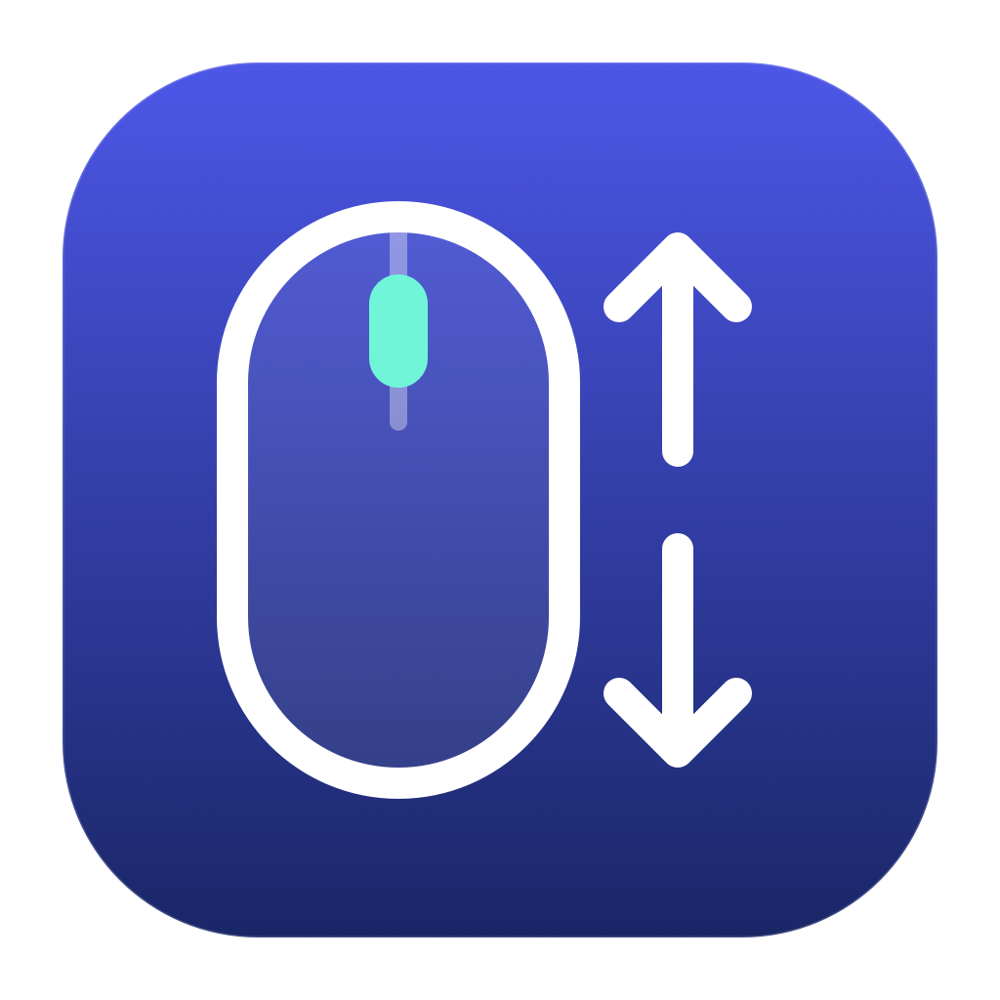

# Smart Middle Click Autoscroll

Windows-style middle-button autoscroll for macOS, with native middle clicks preserved on links, tabs, and controls.

Middle-click scrollable content, then move the pointer to control speed. Return to the anchor to pause. Click again or press **Esc** to stop.

[Download the latest release](https://github.com/devanshkmishra/smart-middle-click-autoscroll/releases/latest)

## Install

Requires **macOS 13 or later**. The universal app includes Apple Silicon and Intel builds.

1. Download and unzip the app from Releases, then move **Smart Middle Click Autoscroll.app** to Applications.
2. Open it and enable **Smart Middle Click Autoscroll** in **System Settings → Privacy & Security → Accessibility**.
3. Use **Options** in Settings or the **↕** menu-bar icon to pause, change speed, enable horizontal scrolling, or exclude an app.
4. Enable **Start at login** in Settings if you want the app to open when you sign in. Move the app to Applications before enabling it. If macOS requests approval, use **Login Items…** to open its startup settings.

The current release is ad-hoc signed and **not notarized**. macOS may block the first launch. If you trust the download, follow [Apple's instructions for opening an unverified app](https://support.apple.com/102445), or build from source. Release downloads include a SHA-256 checksum.

Closing Settings keeps the app running. Quit from Options or the menu bar to stop it. **Show in Dock** is enabled by default; clicking its Dock icon reopens Settings. Startup is opt-in and uses macOS Login Items.

## Behavior

| Middle-click target | Behavior |
| --- | --- |
| Ordinary content with a scrollable ancestor | Start autoscroll |
| Link, tab, button, editable field, or recognized control | Preserve the native click |
| Unknown target, slow Accessibility response, or excluded app | Preserve the native click |
| Click with a keyboard modifier or another mouse button held | Preserve the native click |

While scrolling, the next click stops scrolling and is consumed. Wheel scrolling, app switching, and keyboard input also stop it. Holding the middle button and moving can scroll until release, if your mouse driver passes the held gesture through.

This is a system-wide utility, but compatibility depends on each app's Accessibility support. Custom canvases, games, and widgets may need an exclusion. Several terminal, design, and 3D apps are excluded by default; use **Apps keeping native middle click** to change that list.

Mouse remappers can coexist if they still deliver a middle click. Disable competing autoscroll features or browser extensions.

## Troubleshooting

If the menu-bar icon is obscured, reopen the app from the Dock or Finder and use **Options**. The app menu also offers **Show Menu Bar Icon**. macOS may obscure status items when the menu bar is crowded.

Open **Diagnostics** from Options or the menu bar to see the last routing decision and input/scroll counters. **Retry input listener** restarts the listener. After replacing or rebuilding this ad-hoc signed app, macOS may require removing and re-adding its Accessibility entry.

For a repeatable check, open [TestPage.html](TestPage.html) locally and follow the [manual test guide](docs/testing.md). Actual scrolling and pointer movement were verified in Arc on Apple Silicon. Other apps and Intel hardware have not all been tested.

## Privacy

Processing stays on your Mac. There is no network client, telemetry, updater, key log, or page-text storage. Accessibility reads roles, actions, editability, parent relationships, and scrollbars. Input events are handled in memory; preferences and excluded app identifiers are stored locally. Help and support links open in your browser only when selected.

## Build

Install Xcode or Apple's Command Line Tools, then run:

```sh
./scripts/test.sh
./scripts/build.sh
./scripts/package.sh
```

Build output goes to `dist/`. Both architectures are compiled with the macOS SDK; no package dependencies are required. `package.sh` builds the app, creates a ZIP, and writes `SHA256SUMS.txt`.

The tests cover gesture ownership, native-click replay, timeouts, cancellation, target rules, scroll speed, and event construction. The event-source checks require access to a macOS WindowServer session. Automated tests do not replace physical mouse testing.

See [CONTRIBUTING.md](CONTRIBUTING.md) for implementation notes and release steps.

## Remove

Turn off **Start at login**, quit the app, delete it from Applications, and remove its Accessibility entry. It does not install a background service or change mouse-driver settings.

## License

[MIT](LICENSE)
